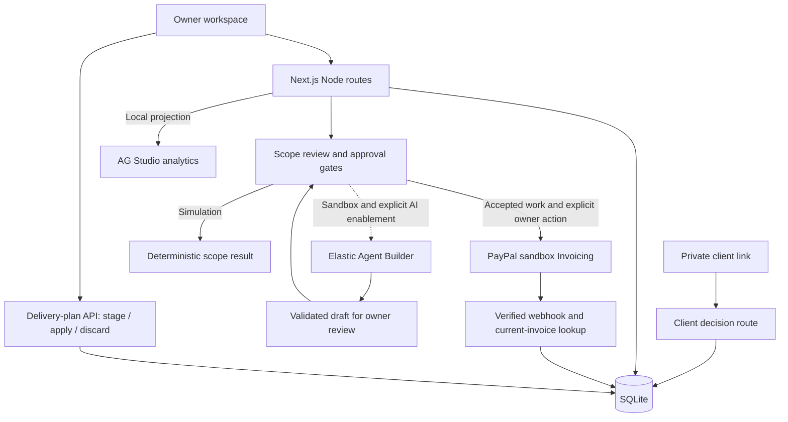

# F3a: architecture and evidence audit

October 15, 2026. Current source and saved verification reviewed without running the application, loading private configuration or contacting providers. This is a documentation audit, not a new test run, independent security certification or proof of product demand. F3b remains the final refresh after actual live, human and hosted outcomes.

## Current flow and authority

The diagram separates the selected Elastic path from deterministic simulation. It does not claim that the complete website live-AI journey is verified. A client approval is a bearer-link holder's recorded decision, not verified identity or a guaranteed legally binding signature.

| Boundary | Source inspected | Actual behavior and limit |
| --- | --- | --- |
| Owner access | `lib/auth.ts`, `app/api/session/route.ts` | Sandbox routes use signed eight-hour owner sessions. Demo mode deliberately skips owner authentication; it is a shared simulation, not isolated public visitor accounts. |
| Client decisions | `app/api/client/[token]/route.ts`, `lib/client-access.ts` | An allowlisted view excludes draft proposals, internal delivery plans and owner-only records. Decisions use POST and recheck the private link after body parsing. New links expire after 30 days; bearer possession is the authority. |
| Scope analysis | `lib/ai.ts`, `lib/elastic-ai.ts`, `lib/ai-payload.ts`, `lib/ai-access.ts` | Demo uses deterministic analysis. Sandbox requires explicit real-AI enablement; Elastic is selected in the project plan. Direct Anthropic and Astropods adapters still exist in source, and the code default is Anthropic if no provider is set; they are not newly selected integrations. Actual private environment settings were not inspected. |
| Data sent to AI | `lib/ai-payload.ts` | Explicit payload contains agreement title, clause IDs/text and the request. Structured contact, price and payment metadata are omitted. User free text is preserved and can still contain private information; this is not anonymization. |
| Money and approval | `app/api/workspace/route.ts`, `lib/domain.ts`, `lib/paypal.ts` | Scope results are drafts, separate from reviewed prices and client acceptance. Invoice creation requires accepted work; create/send are separate actions. Amounts use integer USD cents. The model has no PayPal execution tools or credentials. |
| External recovery | `lib/paypal.ts`, `lib/processing.ts`, `lib/store.ts` | Stable request identities, cached remote results and unresolved-attempt guards help recovery. These do not establish exactly-once execution for every external endpoint. Reconcile uncertain operations before retrying. |
| Payments | `app/api/paypal/webhook/route.ts`, `lib/reconciliation.ts` | Signed events trigger a current-invoice lookup; event deduplication and state/audit writes are transactional. Workspace reads can perform fallback reconciliation, so a PAID dashboard alone is not webhook evidence. |
| Analytics | `app/api/analytics/route.ts`, `components/analytics.tsx`, `components/studio-canvas.tsx` | Reads a local allowlisted snapshot without reconciliation or seeding. Browser-only AG Studio provides reports and custom widgets, not financial actions. It is not a live PayPal feed or a deployed AI analyst. |
| Dashboard AI | `app/api/analytics/agent/route.ts`, `lib/studio-agent-transport.ts`, `lib/studio-agent-bridge.ts` | Guarded transport, allowance and bridge have offline evidence. The production route registers no adapter and the Studio component registers no AI runner/module. Flags alone cannot activate this feature. Request slots are not a provider-wide token or monetary cap. |
| Delivery plan | `app/api/delivery-plan/route.ts`, `lib/delivery-plan*.ts` | Local owner stage/apply/discard with strict versions, server task identities, immutable original plan and accepted-extra checks. No invoice, client commitment or payment operation is caused by applying a schedule. The Bryntum component is not installed. |
| Persistence | `lib/store.ts`, `DATABASE_RECOVERY.md` | Node's SQLite stores separate demo/sandbox workspace JSON, audit, webhook events and remote-operation records; optional delivery state is inside the workspace. Single Node instance and persistent disk remain the deployment model. No PostgreSQL migration or Render service has been performed. |

## Sponsor attribution and evidence

| Resource | Supportable statement now | What remains unproved or pending |
| --- | --- | --- |
| PayPal | Sandbox Invoicing, checkout, reconciliation, signed event redelivery, rejection and deduplication have development evidence. | Fresh payment-triggered automatic PAID webhook transition and hosted reachability remain unverified. See `WEBHOOK_VERIFICATION.md` and `FRESH_PAYMENT_WEBHOOK_TEST.md`. Orders, Payouts, refunds and MCP are not implemented. |
| Elastic | Dedicated no-tool scope adapter has limited historical live evidence; subsequent strict response and authority tests are offline. | Owner deferred further live calls, full website verification and independent/held-out semantic evaluation. `AI_EVIDENCE_REVIEW.md` preserves incorrect and recovered development outcomes; do not report them as six live passes or accuracy evidence. |
| AG Studio | Installed analytics, theming, editable reports and custom pending-changes/invoice-check widgets have browser evidence. Agent-framework transport/bridge work is offline and unregistered in the website. | Actual live Studio-agent operation, known vendor accessibility findings, hosted/public-source permission and coverage after November 21 remain open. |
| Postman | Local Newman workflow runs without linking a Postman account. Latest saved core receipt has 31 requests, 50 assertions, zero failures, restart persistence and no attempted provider fetch. | That collection does not test the new delivery endpoint. Its separate production HTTP check is ten requests, not Newman coverage or hosted HTTPS evidence. |
| Bryntum | Own delivery backend and /delivery read-only Gantt/table view are implemented with pinned7.3.7 packages. B5a-2 production/browser evidence is in `DELIVERY_VIEW_REVIEW.md`; earlier isolated two-timezone evidence is separate. | Initial plan entry and preview/apply/discard controls remain B5b. Full Gantt/manual accessibility, exact dates, public hosted evaluation, source distribution, judge setup and December15 coverage remain pending. A support email was drafted; sending and a reply are not confirmed. |
| Render | Deployment preparation exists; owner reports USD50 credits valid until October 1, 2027. | No resource provisioned. Exact eligible charges, payment-method requirement, exhaustion behavior, quote and Linux/persistent-disk verification remain open. A credit balance is not a spending cap. |
| Other sponsors | Zapier research exists; Astropods remains inactive. Kernel and Channel3 are conditional on a concrete product need. | No new service, credential connection, trial or paid usage is implied by sponsor availability. |

Saved receipts inspected during this audit: `data/postman-workflow/cf2d9006-41ae-40cf-b7da-aef999f3f02e/summary.json` and `data/postman-workflow/delivery-http-665e74da-e09b-4780-8765-da82d7c1a3ba/summary.json`. Both report success, persistence and no provider-fetch attempt; the latter confirms its owned endpoint closed. These are ignored local artifacts, not required public judge files. Prior 162 offline outcomes, TypeScript and production-build results are recorded in `DELIVERY_API_REVIEW.md`; none were rerun for this documentation-only audit.

## Next work and remaining checks

F3a is complete within this audit scope. B2b is partially complete: owner signup/download and bounded archive review exist; licence permissions remain open. B2c's exact dates and judge coverage are unconfirmed. Next owner action is the prepared Bryntum licensing inquiry; next independent implementation preparation is a B5a interface contract using the existing delivery API, without vendor activation. Actual Gantt integration follows confirmed applicable terms.

Keep deferred R6 Narrator/actual zoom/physical touch, H freelancer validation and E live-AI verification open. Final public release also needs historical privacy decisions, sponsor permissions, stable functional judge access and submission materials. F3b must revisit this matrix after those outcomes rather than presenting this audit as final readiness.
