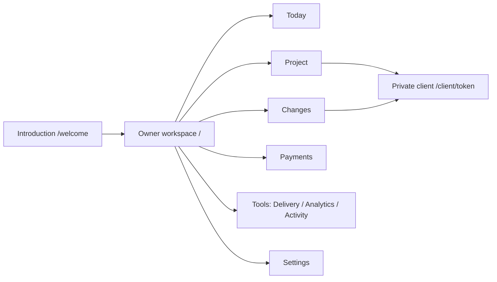

# Nudge — complete frontend design and implementation plan

October28 LATEST PRIORITY: owner defers this visual work until Elastic AI, unresolved backend correctness and Render readiness are handled. CORE_READINESS_CHECKPOINT.md and REVIEW_ACTION_PLAN C1..C5 govern immediate execution. F2-I3 is saved for later, not the next task. No website implementation selected now.

October28 CURRENT DIRECTION: improve the existing application progressively, using its current identity and working components as the base. FRONTEND_REFINEMENT_REVIEW.md and REVIEW_ACTION_PLAN F2-I1..I5 supersede the mandatory template-selection/full-prototype sequence below. I1 plan reconciliation and I2 source/saved-image review are complete; next I3 is an actual owner-heading/Overview refinement with preserved state contracts, followed by source-appropriate verification. The former visual family, proposed navigation and /welcome remain unapproved historical proposals, not implementation instructions. Larger motion/landing changes remain optional after core clarity. Preserve this plan's useful workflow, authority, accessibility and performance boundaries.

October26 OWNER RESET: the owner rejected the FD-A ivory/document visual direction and chose to return to MotionSites selection. FRONTEND_DESIGN_RESET.md is the current art-direction/research/selection authority; the proposed visual family and completed preview below are historical, not approved for integration. Preserve workflow/state/verification contracts. Next show actual references, check selected-item source/licence requirements, then a small hero + real-workspace visual proof before broad implementation. No final template, palette, typography or animation library selected. This user-directed update changes this file's earlier exported hash intentionally; external packets remain historical source snapshots, not current art-direction approval.

October26,2026. Authoritative design workstream under REVIEW_ACTION_PLAN F2-M. Planning is prepared; visual review, app implementation and verification are pending. This is a complete makeover of composition, hierarchy, navigation and interaction. Backend/API/data/financial authority is preserved. No chosen design can guarantee a prize, business impact or absence of regressions.

## 1. What success means

The user should understand what Nudge does, find the next appropriate action and complete the scope-to-payment journey without confronting unrelated controls. Judges must see meaningful PayPal+AI use, a coherent working product, a credible audience/problem and accurate evidence within an under-three-minute presentation. Animation supports those goals. Sponsor features retain real useful roles; they do not dictate homepage decoration or add unsupported product claims.

Primary audience: a freelance web designer handling a fixed-price project and a client reviewing a proposed change. Single owner and one current workspace; no invented client-directory, team accounts, multi-project selector, sign-up service or autonomous payment agent. Impact remains a hypothesis until consenting research supplies evidence.

Core story: accepted scope -> client request -> clause-cited draft -> recorded human review -> owner-set price/explanation -> client acceptance -> separate PayPal sandbox create/send -> authoritative payment status. The fictional example has a USD1200 base and a USD300 booking extra; only the extra was invoiced in the matched example.

## 2. Current implementation and sources of clutter

Inspected app/page.tsx, components/workspace.tsx, components/client-page.tsx, app/layout.tsx, route entry points, existing styles and earlier design/test reports. Current workspace uses one client component with six local views (Overview, Project, Approvals, Payments, Activity, Rules); Analytics and Delivery are separate routes. Overview presents multiple statistics, project scope, scope assistant and supporting context. Approvals and Payments carry several action/recovery workflows. This concentration and repeated presentation are design risks, not measured user-test findings.

| Current surface | Change in presentation | Contract to preserve |
| --- | --- | --- |
| Overview | A focused Today page: current project stage, next useful action, concise monetary context | Existing counts/cent arithmetic and action eligibility; no fabricated forecasts or revenue |
| Project / brief | A readable project record with draft editing separated from locked accepted scope | Draft-only application, immutable approved scope/price, missing-fact review |
| Approvals / assistant | Changes list -> one selected review with evidence and decision/pricing | Clause IDs, editable review, invalidation when deliverables change, no price before required review |
| Payments | Compact invoice list -> selected invoice details and explicit actions | Separate create/send, authoritative status/due, pending/unknown handling and guarded reminders |
| Activity | A readable chronological record, accessible from relevant work | Correct actors, events and uncertainty; no invented audit entries |
| Rules | Settings, connections and private access controls outside the daily canvas | Owner-only controls, explicit confirmation, accurate configured/paused versus verified labels |
| Analytics / Delivery | Consistent shell and optional deeper views | Existing routes/auth, deferred vendors, native tables, guarded plan changes |
| Private client page | A standalone document-like review/receipt experience | Minimal projection, explicit acceptance, exact USD, private/expired link behavior |

## 3. Recommended visual direction

Working name: **Nudge — the project desk**. This is a primary recommendation to prototype, not an owner-approved finished design. Use warm editorial whitespace, crisp document geometry, deep green action surfaces and a restrained paper/evidence motif. The visible makeover comes from hierarchy and composition, not simply recolouring current cards. Inspiration assessment and limits are in FRONTEND_REFERENCE_REVIEW.md.

Candidate tokens, subject to computed contrast and actual render review:

| Role | Candidate |
| --- | --- |
| Canvas / surface | #F6F4EE / #FFFFFF |
| Main ink / secondary ink | #182B24 / #52645B |
| Primary action / soft emphasis | #235C43 / #E7EEE6 |
| Informational border / control boundary | #DCE2D9 / #89988D |
| Caution ink / caution surface | #8D5318 / #FFF3DD |
| Danger ink / danger surface | #A32D35 / #FFF0F0 |

These are proposed colors, not a certified accessible palette. Verify each actual foreground/background, focus indicator, disabled and hover combination. Status always has text; color alone is insufficient.

Typography: explore one expressive editorial heading treatment paired with a highly readable interface sans. Prototype uses system fonts/Georgia to remain self-contained; production may retain existing Manrope/DM Sans or adopt appropriately licensed fonts after review. No paid font assumed. Working app body target16px, secondary14px, small metadata12px with adequate contrast. Avoid tiny uppercase paragraphs. Use tabular numerals for money. Heading size scales by viewport; amounts and controls must wrap rather than clip.

Spacing uses4/8px increments,24–32px card spacing on desktop,16–20px mobile. Corners are consistent, shadows subtle and meaningful. No decorative trust badges or placeholder analytics. Proposed desktop content width1100–1280px, compact navigation rail200–224px, review evidence/decision split approximately60/40 when room allows. At narrow widths preserve evidence-first reading order and use full-width action controls.

## 4. Information architecture and route compatibility

Proposed hierarchy:

Keep `/` as the current owner workspace initially. Add `/welcome` as an independent introduction only after prototype review; its Open workspace link targets `/`. Analytics `/analytics`, Delivery `/delivery` and private `/client/[token]` remain compatible. Do not move authentication behind a marketing page or silently change existing URLs. A root-route migration requires a separate compatibility decision and relevant tests.

Today/Project/Changes/Payments are the primary navigation group. Tools contains Delivery, Analytics and Activity; Settings contains policies/connections/private link controls. These are presentation labels/groups, not new backend resources. Existing view state mapping is explicit: Overview->Today, Approvals->Changes, Rules->Settings. Keep current action handlers until a reviewed extraction can preserve their behavior. No global rewrite of fetch/mutation logic.

Desktop navigation stays compact. Mobile uses a simple labelled menu with native buttons/links; no tiny icon-only bottom bar for nine destinations. Exactly one prominent action per active task, while explicit accept/decline alternatives remain available. Secondary does not mean inaccessible: Activity, settings, reports and recovery controls must be discoverable.

## 5. Screen specifications

### Introduction

Header: Nudge wordmark, How it works anchor, optional actual project/source link once approved, Open workspace. Main headline explains scope changes; supporting sentence identifies freelance designers. Suggested copy for review: “Good work deserves a clear agreement.” Follow with a short precise description of reviewed changes and PayPal sandbox payments.

Hero is a spacious split: clear copy and a purpose-built animated document scene. Below it: three understandable steps; real product/evidence panel; specific human-control explanation; concise tools attribution; final Open workspace CTA. Avoid pricing/signup buttons that have no backend, live customer metrics, testimonials, verified-signature claims or claims of autonomous collection. Any future sponsor marks need permitted assets and accurate attribution. Website UI and submission video are separate deliverables.

### Today

Show project title, environment label, current scope/change/payment stage and one next-action card. Choose the next action from existing server state, with visible blockers; never advance the stage optimistically. Display at most three concise current monetary/decision summaries; preserve current definitions and distinguish approved value, invoiced balance and payments received. Supporting recent activity is short and links to the complete record. Draft brief, advanced reminders, integration settings and charts belong in their dedicated contexts.

### Project

Readable scope document: client/project identity, original USD price, clause IDs/text and approval/acceptance record. Draft editing and manual brief review are deliberate modes. Once approved, show locked scope rather than editable-looking fields. Private link access and sharing remain owner-controlled; never expose the bearer URL in public screenshots or the marketing illustration. New request entry links to Changes, avoiding multiple competing assistants on one screen.

### Changes

List of existing requests with clear state; selected request opens the main canvas. Evidence area: original request, classification draft, actual referenced clause text, missing facts/questions. Review area: human classification/rationale/clauses, separated additional deliverables, recorded review state, then exact owner price and client explanation. Use progressive disclosure to reduce density, but critical unresolved facts, prices and consent must remain visible when deciding. Evidence precedes pricing in reading order. Reviewing a changed set of deliverables invalidates/requires the existing review exactly as today. A changed quote is not silently resubmitted.

### Payments

List gives invoice label/identity, status, total and remaining balance. Detail gives due date, relationship to approved work where available to the owner, current server-confirmed state and context-specific action. Preserve separate create and send approvals, read-only status refresh, unresolved-send/recovery messages, approved reminders and promise-date semantics. DRAFT/UNPAID/PARTIALLY_PAID/PAID/CANCELLED/OTHER each have accurate display. Zero due does not by itself mean paid. A quote is not cash received; a recorded promise is not a payment.

### Private client

Independent client shell with the same brand typography, no owner sidebar/settings. Show the shared scope or change, readable deliverables, supporting approved explanation and exact price. Agreement acceptance retains review checkbox. Quote acceptance/decline remains explicit and separate from paying. Receipt says acceptance did not itself take payment. Invoice cards remain separate: this API does not provide proposalId, so do not invent associations. PayPal links retain current status eligibility and destination policy. Expired/rotated links clear stale controls; temporary read failure clearly labels prior data and pauses decisions.

### Delivery, Analytics, Activity and Settings

Restyle shells and reading hierarchy later using the same tokens. Retain real native tables before opt-in Studio/Gantt, actual report filters/exports/layout controls and explicit date-preview/apply/discard. No new dashboard AI, automatic rescheduling or financial controls added. Chart failure must leave useful data and recovery. Activity retains factual actor/action details. Settings explains what configured credentials enable without calling configuration a successful live integration.

## 6. Signature motion specification

Candidate original scene: a scope document highlights the booking exclusion; an incoming request sits beside it; cited evidence is shown; an owner-reviewed USD300 quote appears; a separate client acceptance is recorded; an illustrative PayPal sandbox invoice/receipt closes the sequence. All marketing figures are labelled fictional illustration. Autoplay is never interpreted as a real action, live AI response or payment.

Use native scroll with a lightweight section reveal or user-operated stage control. No compulsory long scroll before Open workspace works. Text is readable without the animation. Start with CSS/SVG and transform/opacity. Optional Motion adoption needs package/licence/Next compatibility review; do not install multiple animation libraries by default. GSAP, image-to-video, frame sequences and WebGL remain conditional techniques. No external generation credits are committed.

| Interaction | Proposed timing / behavior | Reduced motion |
| --- | --- | --- |
| Button/hover/focus |120–180ms color/opacity; no moving financial text | Immediate or short non-spatial feedback |
| Panel/review transition |180–260ms, subtle transform/opacity; focus preserved or moved deliberately | No sliding; direct state change |
| Successful server save |Brief check/receipt emphasis after confirmed response | Static confirmation and readable status |
| Intro scene |Four to six clear stages; paused/static when out of view or requested | All information readable in static sequence |
| Loading |Skeleton only where geometry is stable; explicit status and timeout/retry behavior | Static placeholder/status |

No animation alters authority, announces duplicate success, counts money toward an invented balance, delays a necessary error, traps scrolling or hides a keyboard target. Motion must be cancellable on navigation/unmount. State changes under polling must not steal focus or discard unsaved review text.

## 7. Functional and accessibility acceptance matrix

Preserve and verify at least: protected owner sign-in/session expiry; initial loading/read failure/retry; stale read/action lock; draft/approved/accepted agreement; AI paused/requesting/failed/invalid; included/additional/ambiguous review; edited-deliverable invalidation; approved/accepted/declined quote; invoice states and partial cents; uncertain create/send/reminder; client consent; expired/rotated links; stale response suppression; optional chart loading/failure; actual keyboard navigation.

Targets: readable320/390/768/1280/1440px layouts; no whole-page horizontal overflow (wide data tables may scroll in named regions);44px primary touch controls as a design goal; visible focus; semantic headings/labels; adequate contrast; accessible validation; reduced-motion and keyboard parity. Sticky controls must not obscure focused elements at actual200/400% zoom. Retain explicit pending status for physical touch/Narrator/real zoom until observed. Automated axe checks are useful and incomplete; do not claim universal compliance.

Use fictional data in dedicated fixtures/builds; do not load ordinary env or spend model credits for design checks. Existing client invoice/recovery/link/keyboard/analytics/delivery tests are the regression baseline. Update tests for intentional labels/layout without weakening their assertions about actions, API state or authority.

## 8. Performance and asset policy

Provisional incremental targets, to confirm by measurement rather than advertise: no additional heavy vendor modules in first render; routine motion uses existing CSS or a small deliberately justified dependency; original static/SVG hero preferred below150KiB compressed; any video/sequence/WebGL proposal must disclose transfer size, decoded-memory strategy, mobile fallback and lifecycle cleanup before acceptance. These are design budgets, not measured current results or guaranteed device performance.

Reserve image dimensions, keep text/primary controls available while graphics load and stop offscreen work. Establish before/after cold-load and interaction measurements on the same fictional build/device conditions; retain outliers and compare sponsor-module loading. Local headless observations do not establish hosted Core Web Vitals or real mobile performance. No huge extracted frame archive enters public/assets by default.

## 9. Parallel ownership

**Primary workspace:** final design decisions, current source/contract inventory, reference review, review of both agents, API/action protection, implementation, verification and action-plan updates. No code is automatically merged from a web agent.

**FD-A — visual design agent:** return an original self-contained HTML/CSS/SVG/JS prototype with Introduction, Today, Change review and Client review views; real responsive layout and reduced-motion behavior, local fictional interactions only. Return a visual rationale and spec. It edits no app file, calls no API and installs nothing. See FRONTEND_AGENT_A_PACKET.md.

**FD-B — state/interaction agent:** independently map current behavior into a state contract, meaningful typed fictional fixtures and proposed fixture tests; explain how view/component boundaries preserve existing handlers. Read source, do not redesign the backend or patch existing files. See FRONTEND_AGENT_B_PACKET.md. It must catch attractive-but-invalid state transitions rather than invent features.

Agents receive separate self-contained packets with current hashes and precise return contracts. Save complete Response3 artifacts in their own agent folders as text/HTML; TypeScript review attachments use .ts.txt. Primary validates source drift, full-file completeness and actual rendered behavior. Shared design plan is a baseline; agents flag proposed deviations, not silently redefine it. No simultaneous edits to the same app files.

## 10. Ordered milestones and stopping points

| ID | Work / evidence | Completion gate |
| --- | --- | --- |
| F2-M1 | Current workflow inventory and primary-source reference review | Desk review prepared; visual preview evidence/limits explicit, rights not assumed |
| F2-M2a | This coherent screen/motion/ownership plan and two packets | Prepared, no app implementation implied |
| FD-A / FD-B | Agent prototype and independent state contract/fixtures | Responses received and reviewed, not automatically accepted |
| F2-M2b | Render prototype at actual widths, exercise all view/state controls, inspect focus/reduced motion and contrast | Select one direction with owner; document necessary revisions |
| F2-M3a | Shared tokens/navigation shell and one core scope-review/client slice | Isolated production/typecheck/targeted regressions; existing state authority unchanged |
| F2-M3b | Project/payment/recovery surfaces and consistent optional tools/settings | Full functional story plus route/sponsor fallbacks; source-matched evidence |
| F2-M3c | Introduction and approved signature motion, linked to actual workspace | Assets/rights/performance/fallback checks; honest demonstration labels |
| F2-M4 | Mobile/reduced-motion/error/keyboard review plus manual R6 and relevant final regressions | Record actual outcomes, retain known gaps; update judge/setup/video documentation |

Do not build a large animated homepage while leaving the payment workspace cluttered. The first functional slice is the scope-review/client journey and shared shell; the intro prototype can be explored in parallel. Stop and reassess if the design requires unapproved backend changes, paid tools, incompatible licences, inaccessible controls or loss of uncertainty safeguards. For any further justified backend proposal, prepare concrete evidence and ask the owner before application.

## 11. What remains outside the makeover

Sponsor continuity/judge access, real user research, independent semantic AI evaluation, full publication/history decisions and final video/submission remain separate tasks. Working prototype access must be functional; design HTML is not the final deliverable. No publication, paid activation or backend change is authorised merely by adopting this plan. Keep the original backend and earlier verified evidence recoverable and compare current source before reusing an old build.
