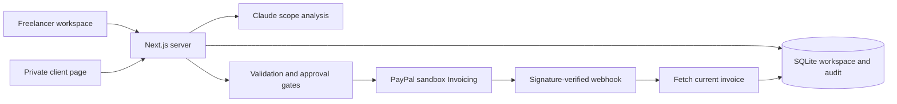

# Nudge

**Get paid for everything you agreed to—and everything that changed.**

Nudge is a scope and payments workspace for freelance designers. A client approves an agreement, AI compares a new request against the actual clauses, the freelancer sets a change price, and the client accepts that price before a PayPal invoice can be created. Payment follow-ups obey explicit rules and require human approval.

This is the first working slice of a hackathon prototype, not a production financial service. MIT licensed.

## Run locally

Requires Node.js **22.13 or later** (Node 24 recommended) and npm. SQLite is built into Node; no database service is needed for this slice.

```sh
npm install
npm run dev
```

On Windows PowerShell, use `npm.cmd` if script execution policy blocks `npm.ps1`.

Open http://127.0.0.1:3000. By default the app runs in **simulation mode**. No AI provider call, email, or PayPal transaction occurs in this mode. The UI explicitly labels simulation. Records persist in `data/nudge.sqlite`, which is excluded from Git.

## Explore the workflow (no credentials)

1. Review the example five-page website agreement. Use **My project → Edit agreement** to change the scope, client details, or original price.
2. Click **Approve scope**. The approved agreement locks.
3. Open **Client view** in another tab, check the review checkbox, and accept the scope. Client decisions appear in the workspace within five seconds.
4. Paste a booking-page request into the scope assistant and choose **Compare with agreement**. Local analysis is an explicitly labeled deterministic simulation, not a working AI integration.
5. Review the cited clauses and questions. Set an additional price, edit deliverables, and approve the proposal.
6. In Client view, accept the change and price.
7. In the workspace, create the change invoice. In **Payments**, approve and send it. In simulation this changes local state only.
8. Choose **Simulate payment**. The client view updates and reminder checks reject paid invoices.
9. For collections controls, add an **overdue example** in Payments. Draft a reminder, then enable **Protect this client** in Agent rules. Trying to send the existing draft is rejected server-side. Confirming a future payment promise also pauses reminders.

You can also create an invoice for the accepted original agreement from Payments. Original work and additional work have separate invoices to avoid billing a change as part of the original price.

## Connect actual PayPal sandbox and AI

Copy `.env.example` to `.env.local` and configure it locally. Do not commit or paste secrets into chat.

```dotenv
NUDGE_MODE=sandbox
PAYPAL_CLIENT_ID=your_sandbox_app_client_id
PAYPAL_CLIENT_SECRET=your_sandbox_app_secret
PAYPAL_MERCHANT_EMAIL=your_sandbox_business_email
PAYPAL_WEBHOOK_ID=your_registered_webhook_id
ANTHROPIC_API_KEY=your_provider_key
ANTHROPIC_MODEL=an_available_tool_use_model_from_your_Claude_console
NUDGE_ADMIN_TOKEN=a_long_random_secret_at_least_24_characters
NUDGE_DB_PATH=./data/nudge.sqlite
```

Restart the server after changing configuration. Sandbox and simulation workspaces are stored separately. Sign in using the admin token. The token is exchanged for an HTTP-only session cookie; provider keys remain on the server.

Run `npm run paypal:check` (`npm.cmd run paypal:check` in PowerShell) to verify sandbox authentication and read-only Invoicing access. It never creates or sends an invoice and does not print credentials or access tokens. The original-agreement invoice flow does not require an AI key, so verify payments first and configure Claude separately. Set the original project price to $10 for the first test, with your sandbox personal buyer email as the client.

1. Create/select a sandbox REST app in the PayPal Developer Dashboard. Use its business sandbox account as the invoicer and a separate personal sandbox account as buyer.
2. Before locking the agreement, replace the example email with your **sandbox buyer email**. The app's invoice recipient is that address.
3. Complete the approval and client acceptance flow. In sandbox mode scope comparison makes an actual Claude tool-use request. A provider failure is surfaced; it never silently falls back to a simulation.
4. Create and send the invoice. Both are actual PayPal sandbox API operations. The client page links to PayPal's hosted invoice payment page.
5. Open that link and pay with the sandbox personal buyer. Do not manually record an external payment as a substitute for demonstrating checkout.
6. Click **Refresh status** to retrieve the authoritative invoice state. For automatic reconciliation, follow the webhook setup below.

The PayPal invoice flow has been verified with an actual USD 10.00 sandbox buyer checkout and authoritative reconciliation to PAID. Authentic webhook delivery and an actual AI provider response remain unverified. AI API usage may cost money; use provider spend limits and sponsor credits where available. No paid services are provisioned by this repository.

## Sponsor AI gateway setup

Nudge can use Claude through Astropods without a separate paid Anthropic API key. The adapter supports the documented Anthropic passthrough endpoint, gateway-specific authentication, and Bedrock model IDs. The same clause validation and human approval rules apply. This integration has passed mocked tests; account authentication and a real model response remain to be verified.

Set these only in your private local environment when Astropods supplies them:

```dotenv
NUDGE_AI_PROVIDER=astropods
ASTRO_GATEWAY_URL=https://YOUR_PROVIDER_SUPPLIED_GATEWAY_HOST
ASTRO_GATEWAY_API_KEY=YOUR_MANAGED_GATEWAY_SECRET
ASTRO_MODEL=bedrock/claude-haiku-4-5
```

Do not copy a guessed gateway address or use your ordinary account login token as a gateway key. Keep the existing direct Anthropic configuration for optional `NUDGE_AI_PROVIDER=anthropic`; neither provider silently replaces errors with simulation.

The official Windows local-agent path requires Docker and the Astropods CLI. Sign in with the CLI's browser/device flow; the platform injects managed gateway configuration into local agent containers. This does not automatically inject credentials into a separately running Next.js process. Complete and verify that local-agent setup before connecting this adapter. No local credential extraction is implemented. Start with a fictional agreement and one model request, compare the reported credits before/after, and do not add a payment method automatically.

References: [CLI and Windows prerequisites](https://docs.astropods.com/install-cli), [First project](https://docs.astropods.com/get-started), [Anthropic API compatibility](https://docs.astropods.com/ai-gateway/anthropic).

## Webhooks

Sponsor offers and the proposed no-cash setup are documented in [SPONSOR_RESOURCES.md](SPONSOR_RESOURCES.md). A read-only Postman collection is available at [postman/nudge-sandbox.postman_collection.json](postman/nudge-sandbox.postman_collection.json). Import it, set sandbox credentials privately and `invoice_id`, and run its three requests in order using the Collection Runner. The access token is kept in run-local variables; no payment operation is included. Clear secret variable values before sharing/exporting a collection. Preparing this collection is not a claim that a Postman run or a sponsor credit redemption has already been performed.

While the authenticated owner workspace is open, a read-only recovery check runs at most once every 30 seconds for up to ten outstanding invoices. This keeps payment status current when webhook delivery is delayed. Results are audited as **PayPal reconciliation**, never as verified webhook delivery. Recovery skips busy workspaces and discards results if a newer action changed the workspace. PayPal failures preserve the last known state for a later retry. This is a local-prototype fallback, not a background scheduler when the workspace is closed.

For local testing, run `node scripts/webhook-relay.mjs` while the app is running on port 3000. The relay listens on loopback port 3001 and forwards only `POST /api/paypal/webhook`; dashboard, session, and client routes are blocked. It preserves PayPal signature headers and the request body, strips authorization and cookies, and limits payloads to 256 KiB. Starting the relay does not open a public connection.

After explicitly approving a temporary HTTPS tunnel, point it at `http://127.0.0.1:3001`, not the app on port 3000. Register the resulting HTTPS URL plus `/api/paypal/webhook` on the **same sandbox REST app**, subscribe to the invoicing events listed in PayPal's current documentation, and set the returned webhook ID in `.env.local`. Restart the app to load that ID. Stop the tunnel after testing; a temporary URL may change on restart and require updating the registration.

The endpoint verifies PayPal's signature using the verification API, deduplicates event IDs, and fetches the current invoice. It does not equate every `INVOICING.INVOICE.PAID` event with full settlement: partial payments use the authoritative outstanding amount. During another action it returns 503, allowing PayPal to retry rather than racing the local update. Simulator events are not a substitute for verified real sandbox invoice events.

Reference: [Invoicing events](https://developer.paypal.com/api/invoicing/webhooks/), [verification](https://developer.paypal.com/api/rest/webhooks/rest/).

The sandbox-only helper `scripts/manage-sandbox-webhook.mjs` supports registration, invoice-event lookup, authentic redelivery, and removal of its own temporary registration. It never prints credentials or full event payloads. For example, after approving a tunnel:

```sh
node --env-file=.env.local scripts/manage-sandbox-webhook.mjs register https://YOUR-HOST.trycloudflare.com/api/paypal/webhook
# Restart Nudge to load the registered webhook ID.
node --env-file=.env.local scripts/manage-sandbox-webhook.mjs events YOUR-SANDBOX-INVOICE-ID
node --env-file=.env.local scripts/manage-sandbox-webhook.mjs resend YOUR-ACTUAL-EVENT-ID
node --env-file=.env.local scripts/manage-sandbox-webhook.mjs cleanup
```

Registration creates only an event subscription, not a payment. An empty event lookup is not proof of delivery. A payment completed before registration may require a separate, explicitly labelled sandbox invoice test. Completion requires a matching **Verified PayPal webhook** audit record, not just a successful registration or resend request. Stop the tunnel after testing and remove its temporary subscription with `cleanup`; restart Nudge after configuration changes.

## What is implemented

- Editable draft agreement with immutable approved clauses and price.
- Private random-token client page with agreement acceptance and change acceptance/decline.
- Actual Claude tool-use adapter for scope classification, evidence references, and clarification questions. Zod validates the shape and the referenced clause IDs.
- Human-priced and human-approved change proposals.
- PayPal sandbox Invoicing adapter: draft creation, separate sending, status retrieval, and reminders.
- Verified, deduplicated webhook reconciliation.
- A single server execution gate and persistent activity trail.
- Reminder template review, protected clients, maximum reminders, cooldown, overdue check, and confirmed payment promises.
- Responsive freelancer/client UI, local persistence, sandbox administrator sign-in, and same-origin mutation checks.

Reminder drafting is currently a deterministic editable template, not AI-written personalized collections. There are no automated/background sends.

## Architecture



Amounts are stored as integer cents; USD only. AI has no payment credentials or execution tool. SQLite transactions serialize local changes, and a processing lock prevents simultaneous owner actions. A stable invoice number, a persisted remote result cache, and stable hashed PayPal request identifiers aid recovery. Creation and sending remain separate because their failure modes differ.

SQLite was chosen for the first local slice so it is runnable without infrastructure. Before deployment use **one Node instance with a persistent disk** and a database backup, or migrate to Postgres. Do not deploy this SQLite version on ephemeral/serverless storage or multiple replicas. The current build is a single-workspace prototype, not a multi-tenant SaaS.

## Checks

```sh
npm run typecheck
npm test
npm run build
npm run test:browser
```

Browser tests start an isolated simulation server on port 3100 and use a separate SQLite database. By default on Windows they use installed Microsoft Edge. Set `NUDGE_BROWSER_PATH` to a Chromium browser executable on other platforms. Tests cover the two-party workflow, invoice acceptance gates, stale reminders after policy changes/payment, private links, cross-origin requests, and mobile overflow. Screenshots go to ignored `test-results/`.

Unit tests cover financial validation, clause citation validation, ambiguous scope, reminder rules, and partial-payment mapping. They do not establish real PayPal or Claude connectivity.

## Current limits and next milestones

- Validate the problem and interface with real freelance designers; example projects are synthetic, with no claimed user savings.
- Verify real sandbox buyer payments and signed webhook delivery with your credentials.
- Evaluate Claude on a labeled set of included/additional/ambiguous requests; valid citations alone do not establish correct interpretation.
- Add rejection/revision of freelancer-side drafts, versioned agreements, onboarding, cancellation, and robust timeout recovery.
- An ambiguous external timeout requires checking PayPal before retrying. The app does not promise exactly-once external execution on every endpoint. A process crash while an action is locked may require manual recovery; do not blindly clear a lock and resend.
- Private client links are bearer capabilities: whoever holds the link can decide. This is not verified identity or a claim of legal contract enforceability. Keep links private; revocation/expiration and client authentication are future work.
- Protect actual sandbox mutation access when hosting. Simulation is for local exploration; the current shared simulation workspace does not isolate public visitors.
- Payouts, natural-language policy compilation, MCP, forecasts, and dispute/refund decisions are not implemented or advertised as working.

See [PROJECT_PLAN.md](PROJECT_PLAN.md) for the one-month milestones and submission checklist.

## Official references

- [PayPal Invoicing](https://developer.paypal.com/api/invoicing/)
- [Create invoice](https://developer.paypal.com/api/invoicing/v2/invoices-create/)
- [Send invoice](https://developer.paypal.com/api/invoicing/v2/invoices-send/)
- [Reminder API](https://developer.paypal.com/api/invoicing/v2/invoices-remind/)
- [Claude tool use](https://platform.claude.com/docs/en/agents-and-tools/tool-use/overview)
- [Hackathon rules](https://paypalaihackathon.devpost.com/rules)
# Invoice recovery safeguards

Sandbox reminder sends persist an unconfirmed delivery marker before contacting PayPal. A successful response clears it and records the reminder once. If the call fails or its response is lost, further reminders for that invoice remain blocked, including replacement drafts. Dismissing the draft or refreshing payment status does not prove delivery and cannot clear this block. The audit records the approved note and attempted delivery. Manual resolution after inspecting delivery evidence is not implemented yet; do not edit the database to bypass the marker. A rejected request also retains the conservative block.

Before sending a sandbox invoice, Nudge retrieves its PayPal status. An already sent, partially paid, or paid invoice is reconciled without another send notification. Failed status lookups block sending. A confirmed send is saved locally before subsequent detail lookup.

Invoice creation records an attempt before contacting PayPal. If the response does not yield a saved invoice ID, another creation attempt is blocked. In Payments, expand **Recover an invoice after a connection error**, choose the accepted work, and enter its original sandbox invoice ID from PayPal's invoice list. Nudge retrieves that invoice using PayPal's [show invoice details endpoint](https://developer.paypal.com/api/invoicing/v2/invoices-get) and checks its invoice number, merchant, recipient, USD total, line item, deliverables, status, and due date before saving it locally. Recovery does not create, send, or pay an invoice; draft sending still requires separate approval.

The conservative block also applies to rejected creation requests. If no matching invoice exists, do not clear operation records blindly: retry authorization after a confirmed rejection remains a pending recovery feature. Known invoice IDs are retained if a later lookup fails. Existing-invoice recovery is verified with mocked responses; a real sandbox recovery exercise is still pending.
