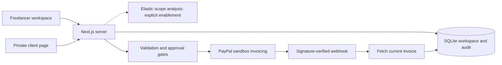

# Nudge

For the pending Windows screen-reader, actual browser-zoom and physical-touch review, see [ACCESSIBILITY_MANUAL_CHECKLIST.md](ACCESSIBILITY_MANUAL_CHECKLIST.md). `npm run a11y:manual` opens a separate fictional loopback session from a matching verified production build, keeping ordinary workspace data and provider credentials isolated. These hands-on results are still pending.

**Get paid for everything you agreed to—and everything that changed.**

Nudge is a scope and payments workspace for freelance designers. A client approves an agreement, AI compares a new request against the actual clauses, the freelancer sets a change price, and the client accepts that price before a PayPal invoice can be created. Payment follow-ups obey explicit rules and require human approval.

This is a working hackathon prototype, not a production financial service. MIT licensed. Start with [JUDGE_SETUP.md](JUDGE_SETUP.md) for a short, credential-free walkthrough; [PROJECT_STATUS.md](PROJECT_STATUS.md) distinguishes implemented features from live verification still pending.

The MIT licence covers Nudge's original code. AG Studio and Bryntum remain commercial evaluation dependencies; public demo and judge licence coverage are still being confirmed. See [THIRD_PARTY_NOTICES.md](THIRD_PARTY_NOTICES.md), [dependency inventory](DEPENDENCY_LICENSE_INVENTORY.json), [retained direct runtime notices](THIRD_PARTY_LICENSE_TEXTS.txt) and [Bryntum third-party notices](THIRD_PARTY_BRYNTUM_NOTICES.md). Do not publish your evaluation key or vendor packages in the repository.

Before sharing source, run `npm run privacy:check` and read [PUBLIC_SOURCE_REVIEW.md](PUBLIC_SOURCE_REVIEW.md) for its scope and remaining history/artifact checks. The authoritative task sequence and sponsor integration gates are in [REVIEW_ACTION_PLAN.md](REVIEW_ACTION_PLAN.md).

Before making the repository public, follow [PUBLICATION_READINESS.md](PUBLICATION_READINESS.md): older history disclosures, sponsor publication permissions and actual GitHub settings still need review. A clear current-source scan does not clear those gates.

Payment reconciliation validates invoice identity, approved USD totals and consistent balances before recording payment. See [PAYMENT_INTEGRITY.md](PAYMENT_INTEGRITY.md) for tested behavior and remaining sandbox verification.

## Run locally

Requires Node.js **22.16 or later** (Node 24 recommended) and npm. SQLite is built into Node; no database service is needed for this slice. The minimum includes the database backup API used by maintenance tools and their tests.

```sh
npm ci
npm run dev
```

On Windows PowerShell, use `npm.cmd` if script execution policy blocks `npm.ps1`.

Open http://127.0.0.1:3000. By default the app runs in **simulation mode**. No AI provider call, email, or PayPal transaction occurs in this mode. The UI explicitly labels simulation. Records persist in `data/nudge.sqlite`, which is excluded from Git.

The committed lockfile is required for `npm ci`. Do not copy another developer's `.env.local` or database. Docker, sponsor accounts and API keys are not needed for simulation. Stop the local server with Ctrl+C. For a production-mode local check, run `npm run build`, then `npm run start -- --hostname 127.0.0.1`; use the same URL.

## Explore the workflow (no credentials)

1. Review the example five-page website agreement. Use **My project → Edit agreement** to change the scope, client details, or original price.
2. Click **Approve scope**. The approved agreement locks.
3. Open **Client view** in another tab, check the review checkbox, and accept the scope. Client decisions appear in the workspace within five seconds.
4. Paste a booking-page request into the scope assistant and choose **Compare with agreement**. Local analysis is an explicitly labeled deterministic simulation, not a working AI integration.
5. Review the cited clauses and questions. In **Your scope decision**, record included, unclear, or additional work with a rationale and supporting clauses or documented clarification. Included/unclear decisions cannot become a paid extra. For mixed requests, edit deliverables to include only extras, then record the decision. Set the additional price and optionally write an explanation for your client. Review the message and its supporting clauses, confirm the quote contains only reviewed extra work, and approve the proposal. Editing deliverables requires another scope review.
6. In Client view, review the approved explanation, work and price, then accept the change. Supporting clause text is saved with the quote. See [CLIENT_CHANGE_EXPLANATION.md](CLIENT_CHANGE_EXPLANATION.md).
7. In the workspace, create the change invoice. In **Payments**, approve and send it. In simulation this changes local state only.
8. Choose **Simulate payment**. The client view updates and reminder checks reject paid invoices.
9. For collections controls, add an **overdue example** in Payments. Draft a reminder, then enable **Protect this client** in Agent rules. Trying to send the existing draft is rejected server-side. Confirming a future payment promise also pauses reminders.

You can also create an invoice for the accepted original agreement from Payments. Original work and additional work have separate invoices to avoid billing a change as part of the original price.

## Explore AG Studio analytics

Open the workspace first, then choose **Analytics**. The embedded Studio page shows recorded invoice balances, ageing and change quotes; report editing does not alter financial records. It reads the protected local analytics snapshot without checking PayPal or calling AI. In sandbox mode the existing owner session is required.

AG Studio is a commercial dependency with local evaluation support. For a licensed hosted demo, privately configure `NUDGE_AG_STUDIO_LICENSE` in `.env.local` and restart; never commit its value. The browser runtime licence is intentionally visible to the vendor component. Licence receipt is owner-confirmed, but exact expiry/judging coverage and local validation remain pending. See [AG_STUDIO_INTEGRATION.md](AG_STUDIO_INTEGRATION.md) for setup, verification and remaining custom-widget/agent work.

## Connect actual PayPal sandbox and AI

Real AI requests are **disabled by default**, even with configured keys. Leave `NUDGE_AI_ENABLED=false` while sponsor allowance is unresolved. Only set it to `true` locally after confirming provider access, usage allowance and the scope of the first test, then restart the server. The owner UI shows paused usage and the server rejects attempts to bypass it. This switch is not a token/dollar cap: provider controls and consumption review are still required. PayPal sandbox operation and credential-free simulation do not depend on this AI flag.

Copy `.env.example` to `.env.local` and configure it locally. Do not commit or paste secrets into chat.

```dotenv
NUDGE_MODE=sandbox
PAYPAL_CLIENT_ID=your_sandbox_app_client_id
PAYPAL_CLIENT_SECRET=your_sandbox_app_secret
PAYPAL_MERCHANT_EMAIL=your_sandbox_business_email
PAYPAL_WEBHOOK_ID=your_registered_webhook_id
ANTHROPIC_API_KEY=your_provider_key
ANTHROPIC_MODEL=an_available_tool_use_model_from_your_Claude_console
NUDGE_ADMIN_TOKEN=a_long_random_secret_at_least_24_characters
NUDGE_DB_PATH=./data/nudge.sqlite
```

Restart the server after changing configuration. Sandbox and simulation workspaces are stored separately. Sign in using the admin token. The token is exchanged for an HTTP-only session cookie; provider keys remain on the server.

Run `npm run paypal:check` (`npm.cmd run paypal:check` in PowerShell) to verify sandbox authentication and read-only Invoicing access. It never creates or sends an invoice and does not print credentials or access tokens. The original-agreement invoice flow does not require an AI key, so verify payments first and configure Claude separately. Set the original project price to $10 for the first test, with your sandbox personal buyer email as the client.

1. Create/select a sandbox REST app in the PayPal Developer Dashboard. Use its business sandbox account as the invoicer and a separate personal sandbox account as buyer.
2. Before locking the agreement, replace the example email with your **sandbox buyer email**. The app's invoice recipient is that address.
3. Complete the approval and client acceptance flow. Sandbox scope comparison uses the selected AI provider only after the explicit enable checkpoint. A provider failure is surfaced; it never silently falls back to a simulation.
4. Create and send the invoice. Both are actual PayPal sandbox API operations. The client page links to PayPal's hosted invoice payment page.
5. Open that link and pay with the sandbox personal buyer. Do not manually record an external payment as a substitute for demonstrating checkout.
6. Click **Refresh status** to retrieve the authoritative invoice state. For automatic reconciliation, follow the webhook setup below.

The PayPal invoice flow has been verified with an actual USD 10.00 sandbox buyer checkout and authoritative reconciliation to PAID. Genuine signed delivery and deduplication have also been verified by redelivering an existing SENT event for an already-paid sandbox invoice; a fresh payment-triggered PAID delivery remains pending. See [WEBHOOK_VERIFICATION.md](WEBHOOK_VERIFICATION.md). Actual Elastic scope-review responses, including the corrected booking regression, are verified with fictional data; website AI and broader quality evaluation remain pending. See [ELASTIC_VERIFICATION.md](ELASTIC_VERIFICATION.md). AI API usage may cost money; use provider spend limits and sponsor credits where available. No paid services are provisioned by this repository.

## Sponsor AI gateway setup

Elastic Cloud Agent Builder is supported through the server-side converse adapter, with strict JSON/clause validation, private isolated requests, disabled tool/skill overrides and zero-price human-review drafts. Live scope-review requests are verified using explicit Sonnet 5 selection and local execution within Elastic's authenticated server request. Keep `NUDGE_AI_ENABLED=false` until the next usage checkpoint is approved. See [ELASTIC_VERIFICATION.md](ELASTIC_VERIFICATION.md) for measured usage and output-quality limitations, and [ELASTIC_INTEGRATION.md](ELASTIC_INTEGRATION.md) for configuration; provider credentials stay local and do not belong in frontend code.

Scope adapters use a shared non-interactive policy with explicit handling of unknown revision counts, booking-button ambiguity and mixed work. Known development responses now clarify missing facts and keep unresolved work out of paid extras. The Elastic adapter accepts bare JSON or one standalone JSON code block, with strict schema/citation checks; prose, blank text, duplicate citations and interactive/tool outcomes are rejected. [SCOPE_CHALLENGE_VERIFICATION.md](SCOPE_CHALLENGE_VERIFICATION.md) records six case inspections, earlier failures, the retained missing-S7 check, and live versus recovered/offline evidence. Human scope/pricing review remains required; this is not a held-out benchmark or live website walkthrough. [ELASTIC_AGENT_INSTRUCTIONS.md](ELASTIC_AGENT_INSTRUCTIONS.md) contains the saved-agent copy, and [ISSUE_CHECKPOINTS.md](ISSUE_CHECKPOINTS.md) tracks open checks.

Current sponsor checkpoint: Elastic managed-model access has worked on the owner's free trial, extended through November 3; exact fair-use capacity and access during judging remain under review. Ordinary website AI remains paused. Astropods has a mocked adapter and reserved signup credits; real gateway access remains unverified. Sponsor setup is optional for local simulation. See [SPONSOR_RESOURCES.md](SPONSOR_RESOURCES.md) for all sponsor fit assessments; do not activate billing or assume a trial covers all future usage.

Render hosting preparation is in [RENDER_DEPLOYMENT.md](RENDER_DEPLOYMENT.md), with a review-only Blueprint, guarded startup and generic database health route. No deployment or sponsor-credit redemption is claimed. The SQLite design needs persistent storage and verified coverage through judging before hosted activation.

Nudge can use Claude through Astropods without a separate paid Anthropic API key. The adapter supports the documented Anthropic passthrough endpoint, gateway-specific authentication, and Bedrock model IDs. The same clause validation and human approval rules apply. This integration has passed mocked tests; account authentication and a real model response remain to be verified.

Set these only in your private local environment when Astropods supplies them:

```dotenv
NUDGE_AI_PROVIDER=astropods
ASTRO_GATEWAY_URL=https://YOUR_PROVIDER_SUPPLIED_GATEWAY_HOST
ASTRO_GATEWAY_API_KEY=YOUR_MANAGED_GATEWAY_SECRET
ASTRO_MODEL=bedrock/claude-haiku-4-5
```

Do not copy a guessed gateway address or use your ordinary account login token as a gateway key. Keep the existing direct Anthropic configuration for optional `NUDGE_AI_PROVIDER=anthropic`; neither provider silently replaces errors with simulation.

The official Windows local-agent path requires Docker and the Astropods CLI. Sign in with the CLI's browser/device flow; the platform injects managed gateway configuration into local agent containers. This does not automatically inject credentials into a separately running Next.js process. Complete and verify that local-agent setup before connecting this adapter. No local credential extraction is implemented. Start with a fictional agreement and one model request, compare the reported credits before/after, and do not add a payment method automatically.

References: [CLI and Windows prerequisites](https://docs.astropods.com/install-cli), [First project](https://docs.astropods.com/get-started), [Anthropic API compatibility](https://docs.astropods.com/ai-gateway/anthropic).

## Webhooks

Sponsor offers and the proposed no-cash setup are documented in [SPONSOR_RESOURCES.md](SPONSOR_RESOURCES.md). The read-only [Postman collection](postman/nudge-sandbox.postman_collection.json) has now run through Newman against sandbox: three HTTP 200 responses and four passing assertions. See [POSTMAN_VERIFICATION.md](POSTMAN_VERIFICATION.md) for repeatable private setup, sanitized output and limits. Desktop Collection Runner is also an option: configure credentials and `invoice_id` privately, run in order, and clear secrets before sharing/exporting. No financial operation is included in that sandbox collection; desktop execution or sponsor-credit redemption is not claimed.

For repeatable backend workflow checks without provider credentials or credits, `npm run postman:workflow` builds a disposable copy and executes a separate [Postman workflow collection](postman/nudge-workflow.postman_collection.json) on an owned local server/database. Verified: 31 HTTP requests and 50 assertions across agreement approval, human scope review, client acceptance, simulated invoicing/payment, duplicate prevention and rejection paths. Model/payment behavior is simulated; Nudge HTTP routes are real. See [POSTMAN_WORKFLOW_VERIFICATION.md](POSTMAN_WORKFLOW_VERIFICATION.md) for the optional pinned Newman install, isolation boundaries and evidence. Do not run this write-containing collection against your ordinary workspace.

Judges can use [POSTMAN_JUDGE_GUIDE.md](POSTMAN_JUDGE_GUIDE.md) for exact setup/run commands, expected results and tool attribution. No desktop/cloud account is required; private sandbox reproduction remains separately authorized.

After installing that optional Newman tool, `npm run verify:clean` additionally checks a current source snapshot with a fresh locked application install, TypeScript, offline tests and the production workflow/restart check. It uses ignored test copies/cache and needs npm registry access; it does not load your .env.local or link your original application dependencies. See [CLEAN_CHECKOUT_VERIFICATION.md](CLEAN_CHECKOUT_VERIFICATION.md) for the recorded evidence and limits.

While the authenticated owner workspace is open, a read-only recovery check runs at most once every 30 seconds for up to ten outstanding invoices. This keeps payment status current when webhook delivery is delayed. Results are audited as **PayPal reconciliation**, never as verified webhook delivery. Recovery skips busy workspaces and discards results if a newer action changed the workspace. PayPal failures preserve the last known state for a later retry. This is a local-prototype fallback, not a background scheduler when the workspace is closed.

For local testing, run `node scripts/webhook-relay.mjs` while the app is running on port 3000. The relay listens on loopback port 3001 and forwards only `POST /api/paypal/webhook`; dashboard, session, and client routes are blocked. It preserves PayPal signature headers and the request body, strips authorization and cookies, and limits payloads to 256 KiB. Starting the relay does not open a public connection.

After explicitly approving a temporary HTTPS tunnel, point it at `http://127.0.0.1:3001`, not the app on port 3000. Register the resulting HTTPS URL plus `/api/paypal/webhook` on the **same sandbox REST app**, subscribe to the invoicing events listed in PayPal's current documentation, and set the returned webhook ID in `.env.local`. Restart the app to load that ID. Stop the tunnel after testing; a temporary URL may change on restart and require updating the registration.

The endpoint verifies PayPal's signature using the verification API, deduplicates event IDs, and fetches the current invoice. It does not equate every `INVOICING.INVOICE.PAID` event with full settlement: partial payments use the authoritative outstanding amount. During another action it returns 503, allowing PayPal to retry rather than racing the local update. Simulator events are not a substitute for verified real sandbox invoice events.

Reference: [Invoicing events](https://developer.paypal.com/api/invoicing/webhooks/), [verification](https://developer.paypal.com/api/rest/webhooks/rest/).

The sandbox-only helper `scripts/manage-sandbox-webhook.mjs` supports registration, invoice-event lookup, authentic redelivery, and removal of its own temporary registration. It never prints credentials or full event payloads. For example, after approving a tunnel:

```sh
node --env-file=.env.local scripts/manage-sandbox-webhook.mjs register https://YOUR-TUNNEL-HOST/api/paypal/webhook
# Restart Nudge to load the registered webhook ID.
node --env-file=.env.local scripts/manage-sandbox-webhook.mjs events YOUR-SANDBOX-INVOICE-ID
node --env-file=.env.local scripts/manage-sandbox-webhook.mjs resend YOUR-ACTUAL-EVENT-ID
node --env-file=.env.local scripts/manage-sandbox-webhook.mjs cleanup
```

Registration creates only an event subscription, not a payment. An empty event lookup is not proof of delivery. A payment completed before registration may require a separate, explicitly labelled sandbox invoice test. Completion requires a matching **Verified PayPal webhook** audit record, not just a successful registration or resend request. Stop the tunnel after testing and remove its temporary subscription with `cleanup`; restart Nudge after configuration changes.

## What is implemented

- Editable draft agreement with immutable approved clauses and price.
- Manual brief review with source notes, issue resolutions, exact USD validation and separate draft application. Structured extraction and evaluation fixtures are prepared and mock-tested; automatic extraction is not connected to the website or a provider.
- Private random-token client page with agreement acceptance and change acceptance/decline.
- Owner-confirmed client-link replacement that preserves acceptance and stable invoice identity.
- Actual Claude tool-use adapter for scope classification, evidence references, and clarification questions. Zod validates the shape and the referenced clause IDs.
- Human-priced and human-approved change proposals.
- PayPal sandbox Invoicing adapter: draft creation, separate sending, status retrieval, and reminders.
- Signature-verified webhook reconciliation and deduplication, verified with genuine redelivery of an existing sandbox event; fresh payment-triggered delivery remains pending.
- A single server execution gate and persistent activity trail.
- Same-host interrupted-process recovery, stale-result ownership checks and persisted uncertain-send blocking; see [PROCESSING_RECOVERY.md](PROCESSING_RECOVERY.md).
- Reminder template review, protected clients, maximum reminders, cooldown, overdue check, and confirmed payment promises.
- Responsive freelancer/client UI, local persistence, sandbox administrator sign-in, and same-origin mutation checks.

Reminder drafting is currently a deterministic editable template, not AI-written personalized collections. There are no automated/background sends.

## Architecture

See [the architecture and evidence audit](ARCHITECTURE_REVIEW.md) for source authority, actual sponsor use and the distinction between implemented, offline-tested and live-verified behavior.

The owner-only **Delivery** page at `/delivery` supports owner-entered estimates after agreement acceptance, separate save-preview/apply/discard decisions, current/original/proposed date tables, an optional read-only Bryntum Gantt timeline and local payment context. It never checks PayPal or saves chart edits. A fresh workspace correctly shows no plan. Extra work must be reviewed and client-accepted before applying; stale or unconfirmed outcomes require refresh and review. The backend enforces server IDs, versions, scope, calendar and transaction checks. Unsaved edits stay in page memory and are lost on navigation. See [planning evidence](DELIVERY_PLANNING_REVIEW.md), [delivery view evidence](DELIVERY_VIEW_REVIEW.md), [API evidence](DELIVERY_API_REVIEW.md) and [Bryntum integration plan](BRYNTUM_PLAN.md). Local trial use does not clear public demo/judging permissions.



Amounts are stored as integer cents; USD only. AI has no payment credentials or execution tool. SQLite transactions serialize local changes, and a processing lock prevents simultaneous owner actions. A stable invoice number, a persisted remote result cache, and stable hashed PayPal request identifiers aid recovery. Creation and sending remain separate because their failure modes differ.

SQLite was chosen for the first local slice so it is runnable without infrastructure. Before deployment use **one Node instance with a persistent disk** and a database backup, or migrate to Postgres. Do not deploy this SQLite version on ephemeral/serverless storage or multiple replicas. The current build is a single-workspace prototype, not a multi-tenant SaaS.

Local snapshot/verification/offline-recovery commands are documented in [DATABASE_RECOVERY.md](DATABASE_RECOVERY.md). They preserve webhook and remote-operation records and never replace the active database automatically. Maintenance needs Node 22.16+; Node 24 is recommended. Recovery copies contain private data and need remote-state review before any promotion.

## Checks

```sh
npm run typecheck
npm test
npm run build
npm run test:browser
```

Browser tests start an isolated simulation server on port 3100 and use a separate SQLite database. By default on Windows they use installed Microsoft Edge. Set `NUDGE_BROWSER_PATH` to a Chromium browser executable on other platforms. Tests cover the two-party workflow, invoice acceptance gates, stale reminders after policy changes/payment, private links, cross-origin requests, and mobile overflow. Screenshots go to ignored `test-results/`.

The sandbox-only delivery owner fixture runs separately from that demo server. After a passing `npm.cmd run postman:workflow`, use its printed disposable build directory with `node scripts/check-delivery-browser.mjs data/postman-workflow/<run-id>/app-source`. This targeted Windows/Edge runner checks matching source, creates fresh demo/sandbox databases, runs eleven delivery/core scenarios and verifies provider-fetch silence and closure of its own test ports. See [delivery backend coverage](DELIVERY_BACKEND_REVIEW.md) for the contract matrix and [delivery accessibility review](DELIVERY_ACCESSIBILITY_REVIEW.md) for keyboard/recovery checks and two unresolved vendor ARIA findings. A passing regression records those findings explicitly; it does not certify chart accessibility. The runner does not load your ordinary credentials or database.

Unit tests cover financial validation, clause citation validation, ambiguous scope, reminder rules, and partial-payment mapping. These tests alone do not establish live provider connectivity or model quality.

## Current limits and next milestones

- Validate the problem and interface with real freelance designers; example projects are synthetic, with no claimed user savings.
- Sandbox checkout and signed webhook replay/deduplication have development evidence; verify a fresh payment-triggered webhook transition without owner polling.
- Evaluate the selected Elastic model on independently reviewed included/additional/ambiguous cases and verify the website's live-AI journey after the owner resumes AI work. Valid citations alone do not establish correct interpretation.
- Complete independent freelancer validation, actual assistive-technology checks, judge access/licence continuity and final submission materials. Versioned agreement history, production onboarding and cancellation remain future scope.
- An ambiguous external timeout requires checking PayPal before retrying. The app does not promise exactly-once external execution on every endpoint. Guarded recovery is available for new locks whose owning process is confirmed exited on the same host; legacy/unverifiable locks remain blocked. Unknown invoice sends cannot be repeated just because PayPal still shows DRAFT.
- Private client links are bearer capabilities: whoever holds the link can decide. This is not verified identity or a claim of legal contract enforceability. Keep links private. Replacement revokes the old Nudge URL; new/replacement links expire after30days, while legacy links without expiry are rejected. Client identity verification remains future scope. See [CLIENT_ACCESS.md](CLIENT_ACCESS.md).
- Protect actual sandbox mutation access when hosting. Simulation is for local exploration; the current shared simulation workspace does not isolate public visitors.
- Payouts, natural-language policy compilation, MCP, forecasts, and dispute/refund decisions are not implemented or advertised as working.

See [PROJECT_PLAN.md](PROJECT_PLAN.md) for the one-month milestones and submission checklist.

## Official references

See [OWNER_SESSIONS.md](OWNER_SESSIONS.md) for signed server-enforced owner expiry, required re-login after the cookie format change, and stateless-session limits.

See [PUBLIC_REQUEST_CONTROLS.md](PUBLIC_REQUEST_CONTROLS.md) for client/webhook rate and body limits and the remaining hosted ingress review.

See [AI_DATA_HANDLING.md](AI_DATA_HANDLING.md) for scope-comparison payloads, the owner disclosure and remaining privacy-review boundaries. Free text is not automatically anonymized; use fictional demo content.

See [DATA_LIFECYCLE_REVIEW.md](DATA_LIFECYCLE_REVIEW.md) for retention, reviewed removal/recovery and log boundaries. Routine Next development logging is disabled to avoid exposing private client-link URLs; restart an existing dev server to load this setting. Hosted access logs still require review. Demo reset is not complete deletion, and backups are not encrypted.

Analytics includes an AG Studio Invoice checks widget for recorded status issues and receivables with unknown due dates. It uses the complete local snapshot, unaffected by report filters, and cannot send reminders or change payments. See [INVOICE_CHECKS_WIDGET_REVIEW.md](INVOICE_CHECKS_WIDGET_REVIEW.md) for evidence and limits.

- [PayPal Invoicing](https://developer.paypal.com/api/invoicing/)
- [Create invoice](https://developer.paypal.com/api/invoicing/v2/invoices-create/)
- [Send invoice](https://developer.paypal.com/api/invoicing/v2/invoices-send/)
- [Reminder API](https://developer.paypal.com/api/invoicing/v2/invoices-remind/)
- [Claude tool use](https://platform.claude.com/docs/en/agents-and-tools/tool-use/overview)
- [Hackathon rules](https://paypalaihackathon.devpost.com/rules)
# Invoice recovery safeguards

Sandbox reminder sends persist an unconfirmed delivery marker before contacting PayPal. A successful response clears it and records the reminder once. If the call fails or its response is lost, further reminders for that invoice remain blocked, including replacement drafts. Dismissing the draft or refreshing payment status does not prove delivery and cannot clear this block. The audit records the approved note and attempted delivery. A rejected request also retains the conservative block.

In Payments, **Review uncertain reminder delivery** lets the owner record evidence and explicitly confirm a decision. If unsure, leave blocked or count the attempt as sent, which increments the reminder count once and starts a conservative cooldown at review time. Only choose **Evidence confirms it was not sent** when supported by delivery records or a support response; an absent email alone is not proof. This records operator judgment, not API verification. Review sends nothing, discards the old attempt's draft, and rejects repeated or stale decisions. Any later reminder needs a fresh draft, current policy checks, and separate approval. Do not edit the database to bypass the marker.

Before sending a sandbox invoice, Nudge retrieves its PayPal status. An already sent, partially paid, or paid invoice is reconciled without another send notification. Failed status lookups block sending. A confirmed send is saved locally before subsequent detail lookup.

Invoice creation records an attempt before contacting PayPal. If the response does not yield a saved invoice ID, another creation attempt is blocked. In Payments, expand **Recover an invoice after a connection error**, choose the accepted work, and enter its original sandbox invoice ID from PayPal's invoice list. Nudge retrieves that invoice using PayPal's [show invoice details endpoint](https://developer.paypal.com/api/invoicing/v2/invoices-get) and checks its invoice number, merchant, recipient, USD total, line item, deliverables, status, and due date before saving it locally. Recovery does not create, send, or pay an invoice; draft sending still requires separate approval.

The conservative block also applies to rejected creation requests. If no matching invoice exists, do not clear operation records blindly: retry authorization after a confirmed rejection remains a pending recovery feature. Known invoice IDs are retained if a later lookup fails. Existing-invoice recovery is verified with mocked responses; a real sandbox recovery exercise is still pending.
